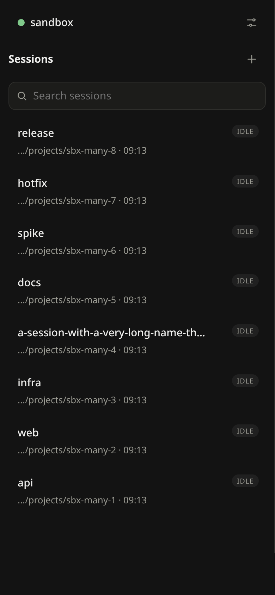
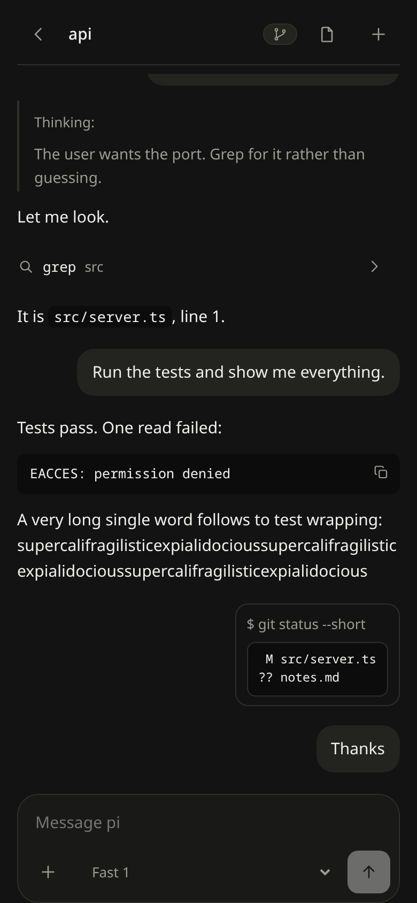
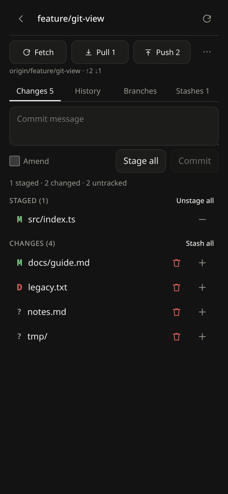
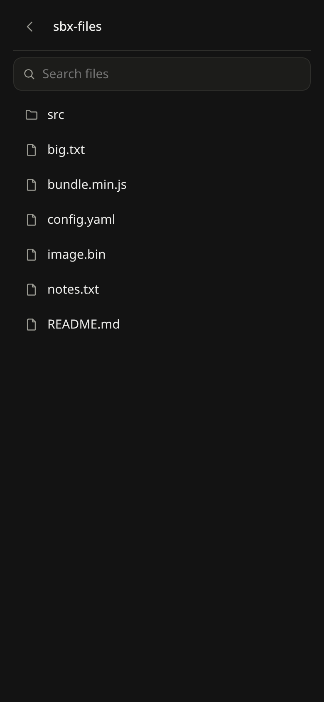

# PiOS

A phone client for the [pi coding agent](https://pi.dev). Run `pi` on your
own machine and drive it from an iPhone (or any browser) as an installable
web app.

PiOS talks to pi's RPC mode, not to a terminal. You get a real chat UI with
drafts, streaming, rendered tool calls, images and dialogs. Sessions keep
running on the machine when the phone sleeps or loses signal, and the app
catches up when it comes back.

<p align="center">
  
  
  
  
</p>

> **Status:** early. Built for Linux hosts and an iPhone; expect rough edges.
> A native app is not built yet.

## Features

- **Sessions:** the session list is pi's own session store, so sessions
  started in the TUI show up too. Start, resume, rename and compact sessions,
  and see an unread mark when a turn finishes.
- **Chat:** streaming text and thinking, collapsible tool cards, steer and
  follow-up while the agent works, retry and error banners, and an interrupt
  button.
- **Composer:** slash commands (`/model`, `/thinking`, `/compact`, `/name`,
  `/export`, `/reload`, ...), `@path` file mentions with fuzzy search, and
  images from the camera, the photo library or the clipboard.
- **Extension UI:** pi extension dialogs (`select`, `confirm`, `input`,
  `editor`) show up as native sheets.
- **Git:** changes, staging, commit and amend, history, branches, stashes,
  fetch, pull and push, and full-width diffs.
- **Files:** browse and search the project, and view or edit files.
- **One-shot shell:** run a single command in the session directory and see
  the output stream in.
- **Terminal:** an interactive shell on a PTY in the session directory, with
  a key bar for Ctrl, Esc, Tab and the arrows. The shell lives on the
  machine, so it survives leaving the screen, a dropped connection or a
  reload, and every device sees the same one.
- **Push notifications** when a turn settles, also for turns finished in the
  TUI. They are skipped while you are watching that session.
- **Offline-safe sending:** prompts go through an outbox with idempotent
  delivery, so a flaky connection never sends a message twice.

## How it works

```
 phone (PWA)  <-- HTTPS/WS -->  Cloudflare relay  <-- outbound WS --  pios-server  -->  pi --mode rpc
```

- **`pios-server`** is a daemon on your machine. It runs one `pi --mode rpc`
  process per session, using your existing pi config, credentials and
  sessions. It also serves the web app.
- **The relay** is a small Cloudflare Worker (the free plan is enough). The
  daemon dials out to it, so nothing on your machine has to be reachable from
  the internet, and you need no VPN or port forwarding.
- **The web app** is installed to the home screen. It pairs with the machine
  through a one-time link.

## Security

**The daemon runs arbitrary code as your user.** That is the point of a
coding agent, so treat a paired phone like an SSH key:

- Every route except pairing needs a device token. Tokens are stored hashed.
- Pairing links last 10 minutes and come with a confirmation code. You can
  revoke devices with `pios-server revoke`.
- The daemon binds to `127.0.0.1` by default. Only the machine that holds the
  enrolled key can act as the daemon behind your relay.
- File serving is limited to the session's directory.

There is no approval or permission layer on top of pi. Whatever pi may do,
the phone may ask it to do.

## Quick start

Requirements: Linux with systemd, Node 22.18+, pnpm, `pi` on `PATH` and logged
in, and a Cloudflare account for the relay.

```sh
pnpm install
# 1. Deploy the relay once: see packages/relay/README.md
# 2. Install the daemon as a systemd user service
PIOS_RELAY_URL=https://pios-relay.<you>.workers.dev packages/server/packaging/install.sh
pios-server relay enroll
# 3. Pair a phone: open the printed link in Safari, then Add to Home Screen
pios-server pair
```

The full guide, with configuration, device management and troubleshooting, is
in [docs/setup.md](docs/setup.md).

## Development

```sh
pnpm test                    # typecheck and every package's tests
pnpm sandbox                 # live app + stub agent, prints a URL that pairs itself
pnpm sandbox:shot --tap api  # phone-sized screenshots into .sandbox/shots
pnpm test:browser            # end-to-end in headless Chrome
```

The sandbox runs the real daemon against a stubbed pi, in temp directories
only. It costs no tokens and never touches your real sessions or
repositories. See [packages/sandbox/README.md](packages/sandbox/README.md).

| Path | What |
|---|---|
| `apps/web` | The PWA (React) |
| `packages/server` | `pios-server`: daemon, HTTP/WS routes, auth, git, files, push |
| `packages/pi-host` | Runs and supervises pi sessions over RPC |
| `packages/protocol` | Wire types and JSONL framing shared by every part |
| `packages/client-core` | Platform-free client logic: sync, outbox, reconnect |
| `packages/relay` | The Cloudflare Worker relay |
| `packages/sandbox` | Stub agent, scenarios and screenshot tooling |
| `spikes` | Protocol probes and recorded RPC traces |

The design and its rationale are in [spec.md](spec.md), and the roadmap is in
[plan.md](plan.md).

## License

[MIT](LICENSE), the same as pi.
